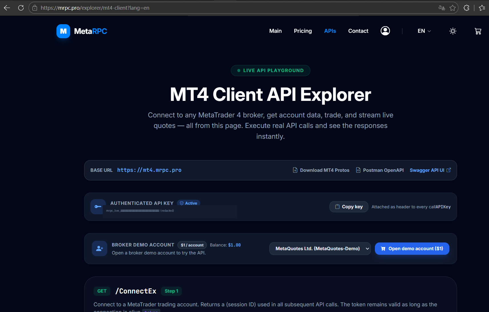

# MT4 for Beginners

> New to MetaTrader 4? This is the 5-minute mental model you need before the code makes sense.

---

## What MT4 is

**MetaTrader 4 (MT4)** is a trading platform. Your **account** lives on a broker's **server** (e.g. `MetaQuotes-Demo` or `EGlobal-Demo`). Through it you trade **symbols** (instruments like `EURUSD` or `XAUUSD`).

This SDK talks to your MT4 terminal over the network (gRPC to `mt4.mrpc.pro:443`) so you can automate everything from Node.js.

> Always learn on a **demo** account. It trades with fake money on real prices — no risk.

---

## Getting a demo account & API key

**Registration and your API key are free.** Sign up at [mrpc.pro/signup](https://mrpc.pro/signup) and your key is provisioned automatically — nothing to generate; in the web Explorer it's even attached to every call for you. What costs money is **paid usage of the service** (for example the instant $1 demo below).

To run the SDK you also need an **MT4 demo account** (login / password / server). You can get one two ways:

### ⚡ Fastest — one click on mrpc.pro ($1)

Our **[MT4 Client API Explorer](https://mrpc.pro/explorer/mt4-client)** (a live API playground) spins up a demo account instantly — no terminal install:

1. Open the **[MT4 Client API Explorer](https://mrpc.pro/explorer/mt4-client)** (sign in first). Your **API key** is already shown under *AUTHENTICATED API KEY* (*Active* · **Copy key**).
2. In the **BROKER DEMO ACCOUNT** panel pick a broker (the dropdown defaults to **MetaQuotes-Demo**) and click **Open demo account ($1)**. The **$1 is charged to your MetaRPC balance** (the account that holds your API key) — *not* to a broker.
3. The demo is created **instantly** with a ready **login / password / server** — you can even run real API calls right on that page (the key is attached automatically).



Copy the demo **login / password / server**, then jump to [Getting Started](./GETTING_STARTED.md) to connect from Node.

### 🖥️ Free — create a demo in the MetaTrader 4 terminal

The no-cost route: create a demo account directly in the MT4 terminal (free), and connect with your free API key — or with the literal value `TRIAL` for a quick first look.

**1 · Download & install MT4.** Get the terminal from your broker, or the generic one from **[metatrader4.com/download](https://www.metatrader4.com/en/download)**, and install it.

**2 · Find the Navigator panel.** It's on the left, below *Market Watch*. Its **Accounts** section is where you add accounts.


**3 · Open a new account.** Right-click **Accounts → Open an account** to bring up the broker-server search.

**4 · Pick a demo server.** Find your broker's `*-Demo` (or **MetaQuotes-Demo**) and click **Next**.


**5 · Choose "Open a new demo account"** and click **Next**.


**6 · Fill in the form** (name, email; virtual deposit e.g. `$10,000`, leverage `1:100`, currency `USD`), accept the terms, **Next**.


**7 · Save your credentials.** MT4 shows your **login**, **password** (master) and **server**. **Copy them now** — the SDK needs exactly these three values.


> Two passwords are shown: the **master** password trades; the **investor** password is read-only. Use the master password with the SDK.

---

## The money words

| Term | In one line |
| ---- | ----------- |
| **Balance** | Your settled money (no open trades counted). |
| **Equity** | Balance **plus** the profit/loss of trades you have open right now. |
| **Margin** | Money "reserved" while a trade is open. |
| **Free margin** | What's left to open new trades. |

When you open a trade, equity moves tick by tick. When you close it, the result folds into balance.

> ⚠️ **On MT4, margin isn't in the account summary.** `getBalance()` / `getEquity()` are cheap reads; `getMargin()` / `getFreeMargin()` / `getMarginLevel()` take a quick **live snapshot** instead (see [Balance & Margin](../MT4Sugar/2.%20Balance_Margin.md)).

---

## Buying and selling

* **Buy** (go long) — you profit if the price **rises**.
* **Sell** (go short) — you profit if the price **falls**.

You trade in **lots** (volume). `0.01` is a micro lot — the smallest typical size, perfect for learning.

Two ways to enter:

* **Market order** — fill **now** at the current price.
* **Pending order** — wait for a price. A **LIMIT** waits for a better price; a **STOP** waits for a breakout.

---

## Protecting a trade

* **Stop-Loss (SL)** — auto-close if the price goes against you by so much. Caps the loss.
* **Take-Profit (TP)** — auto-close once you've made your target.

Set them as prices, or let the SDK compute them from **pip** distances:

```ts
// 20-pip stop, 40-pip target, sized automatically
const lots = await sugar.calculatePositionSize('EURUSD', 1, 20);   // risk 1%
await sugar.buyMarketWithPips('EURUSD', lots, 20, 40);
```

---

## MT4's model: orders by ticket (no positions, no netting)

This is the big difference from MT5, so remember:

* On MT4, **everything is an order** with a unique **ticket** number. A filled market BUY is just an **open market order** (type `0` BUY / `1` SELL); a pending order is a working instruction (types `2–5`: LIMIT / STOP).
* There are **no "positions"** as a separate concept and **no netting** — open two BUYs on `EURUSD` and you have **two independent orders**, each with its own ticket, not one merged position.
* Closed orders move to **history** (with a close time and close price).

In this SDK the friendly layers call open market orders "**positions**" for convenience (`getOpenPositions`, `closePosition`), but under the hood they are MT4 orders addressed by ticket.

---

## Your first 10 lines

```ts
import { MT4Sugar } from '@metarpc/nodemt4';

const sugar = MT4Sugar.create('mt4.mrpc.pro', 443);
await sugar.quickConnect(login, 'password', 'MetaQuotes-Demo');

console.log('balance', await sugar.getBalance());
const ticket = await sugar.buyMarket('EURUSD', 0.01);   // tiny demo trade
await sugar.closePosition(ticket);
```

---

## Next steps

* [Getting Started](./GETTING_STARTED.md) — install and connect properly.
* [Your First Project](./Your_First_Project.md) — build something small.
* [Glossary](./GLOSSARY.md) — every term, defined.
* [MT4Sugar](../MT4Sugar/MT4Sugar.API_Overview.md) — the friendliest API.
